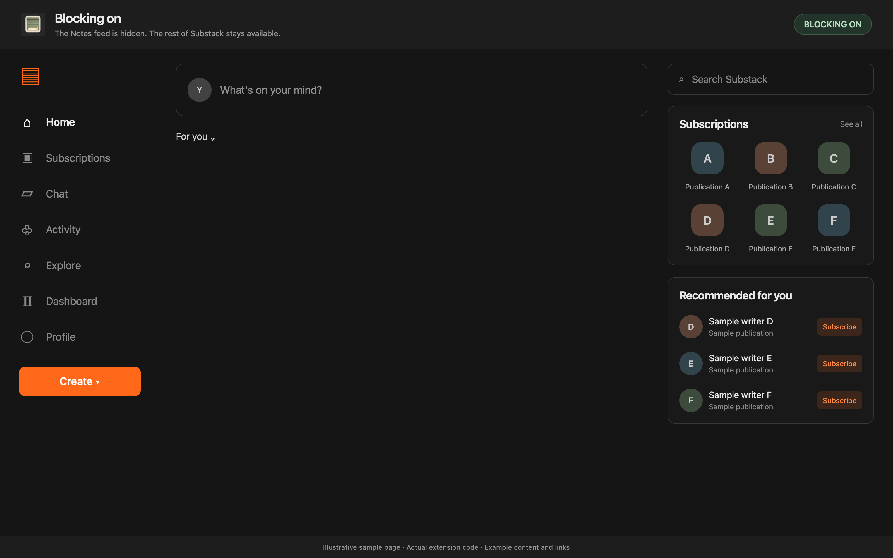
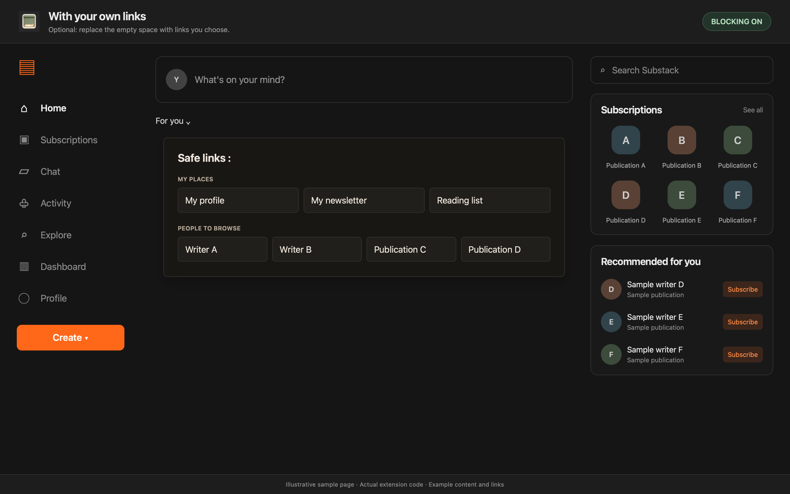
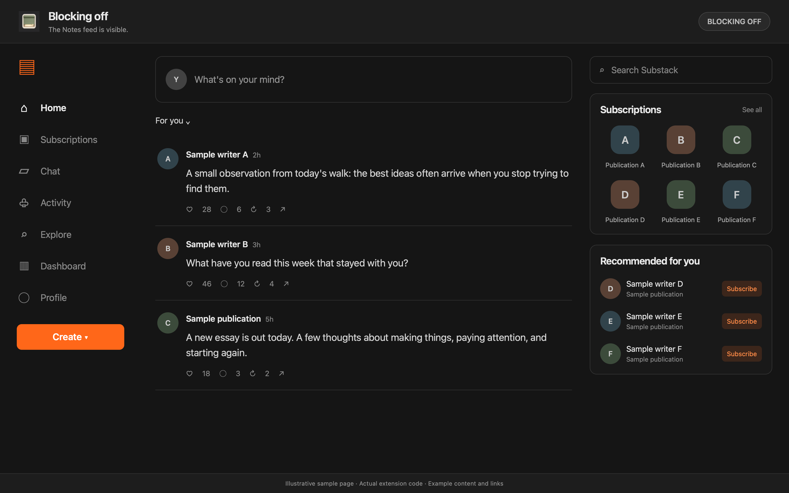

Created by Codex, on [[2026-06-21-Sun]]

# Substack Feed Blocker

A small Chrome extension that hides the Substack Notes feed while keeping notifications, subscriptions, chat, search, profiles, publishing tools and individual posts usable.

## In use

These demos use sample content and the extension's actual code.

**Blocking on:** the Notes feed disappears while the rest of Substack stays available.



**Optional links:** add shortcuts to the profiles, publications or pages you choose.



**Blocking off:** click the toolbar icon to bring the Notes feed back.



## Install in Chrome

1. Use **Code > Download ZIP** in this repository, then extract the downloaded ZIP. You can also clone the repository.
2. Open `chrome://extensions` in Chrome.
3. Turn on **Developer mode**.
4. Click **Load unpacked** and select the extracted folder containing `manifest.json`.
5. Pin the extension if you want its switch to stay visible, then reload open Substack tabs.

Keep that folder in place while the extension is installed. There is no build step or package installation. This is an unpacked extension, not a Chrome Web Store listing.

The feed is hidden by default. Clicking the toolbar icon toggles blocking, and the ON/OFF badge shows the current state. The preference is saved locally.

## Optional links

The public extension starts with an empty `SAFE_LINK_SECTIONS` array in `content.js`; no links panel is shown while it is empty. To add your own links, use this structure:

```js
const SAFE_LINK_SECTIONS = [
  {
    title: "My links",
    links: [
      { label: "Example", url: "https://example.org/" }
    ]
  }
];
```

After editing, reload the extension in `chrome://extensions`, then reload Substack. Keep your personal copy separate from contributions to this repository.

## Privacy and permissions

The extension runs only on `https://substack.com/*`. It stores one local on/off preference and does not send browsing data to any service. Its permissions are local preference storage and access to Substack. Any optional links are ordinary browser links.

## Files

- `manifest.json`: Manifest V3 configuration, permissions and icons.
- `background.js`: toolbar toggle and saved preference.
- `content.js`: feed detection and optional links.
- `content.css`: feed hiding and optional light/dark links panel.
- `icons/`: extension artwork.

## Publication history

- [[2026-10-31-Sat]] - Public version 1.4.8 starts with no personal links or recommendations. The optional panel remains hidden until a user adds links. JavaScript syntax, default blocking behavior and manifest references were checked.

## If Substack changes its site

The extension targets the accessible `Notes feed` region. If the feed reappears after a redesign, check its current accessible label and update the selector in `content.css` and `content.js`.
